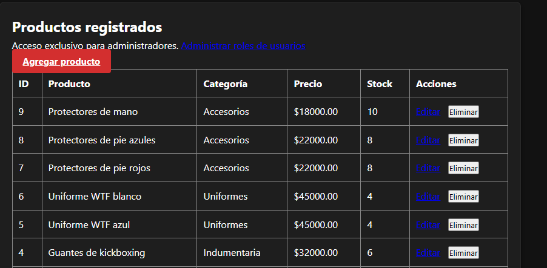
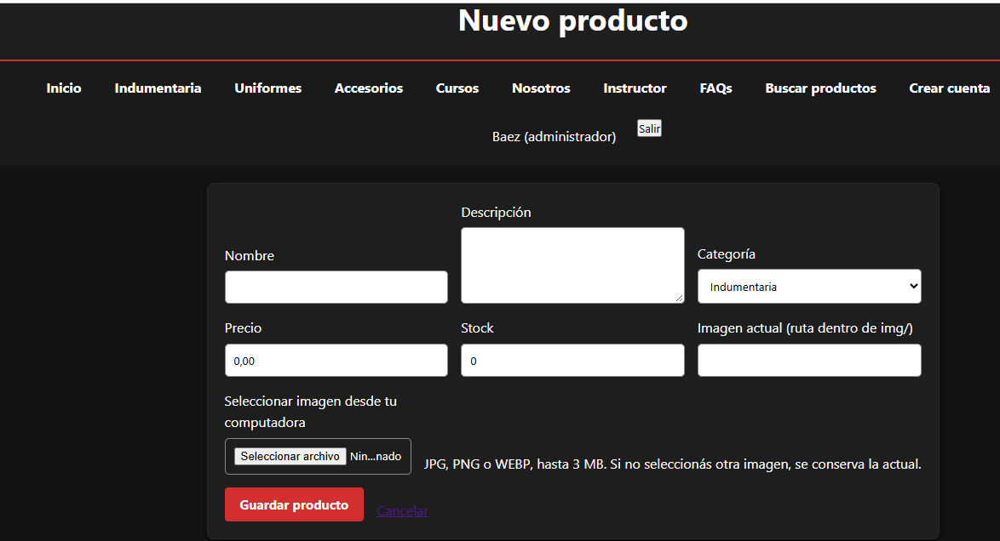
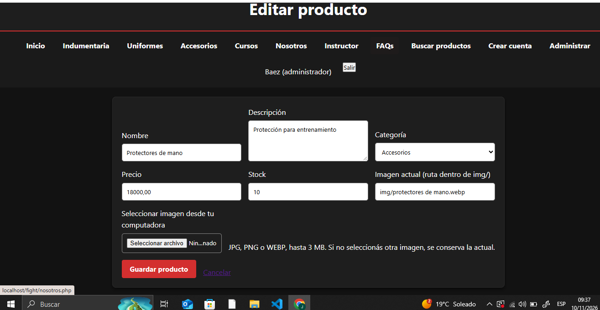

# TP7 — PDO y CRUD de productos

**Proyecto:** Impact Fight

## Objetivo del trabajo

Conectar PHP con MySQL mediante PDO y gestionar desde la web las operaciones CRUD: crear, consultar, modificar y eliminar productos del catálogo.

## Desarrollo observado

Las imágenes muestran un panel administrativo de productos con una tabla que incluye nombre, categoría, precio, stock y acciones. También se observan el formulario **Nuevo producto** y el formulario **Editar producto**, con campos de nombre, descripción, categoría, precio, stock e imagen.

Para que el CRUD cumpla la consigna, los cambios deben persistir en la base MySQL y las consultas con datos de entrada deben ejecutarse con **PDO y sentencias preparadas**. El contenido mostrado al usuario debe escapar valores con `htmlspecialchars()`.

## Evidencias del TP7

**1. READ: listado de productos.**

**2. CREATE: formulario para agregar un producto.**

**3. UPDATE: formulario para modificar un producto.**

## Evidencias pendientes

- **Alta confirmada:** el formulario aparece en la captura, pero falta la prueba de que el nuevo producto se guardó y se ve en el listado.
- **Edición confirmada:** falta mostrar el dato modificado luego de guardar.
- **DELETE:** no hay captura de eliminación de un artículo de prueba.
- **Persistencia:** falta una captura de phpMyAdmin mostrando el registro guardado o modificado desde el panel.

Se recomienda crear un artículo ficticio como `Producto TP7`, comprobarlo en la tabla, modificarle el precio, volver a comprobarlo y eliminar solo ese registro de prueba. Nunca borrar datos reales para preparar la demostración.

## Conclusión

El panel permite administrar el catálogo desde una interfaz web. Las operaciones completas se consideran comprobadas cuando los cambios se guardan realmente en MySQL y se pueden leer después de recargar la página.
